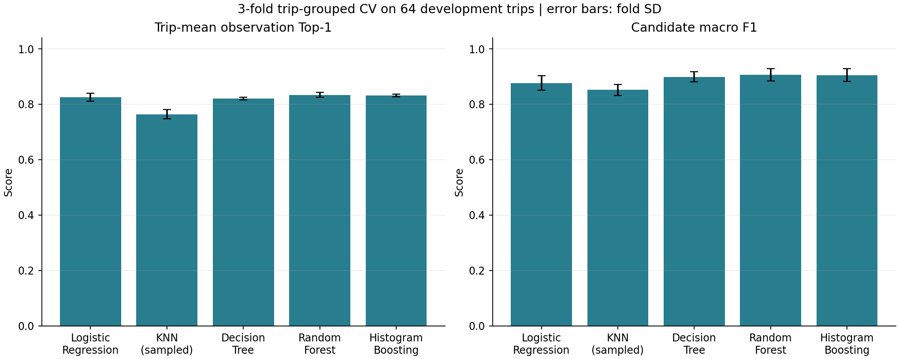
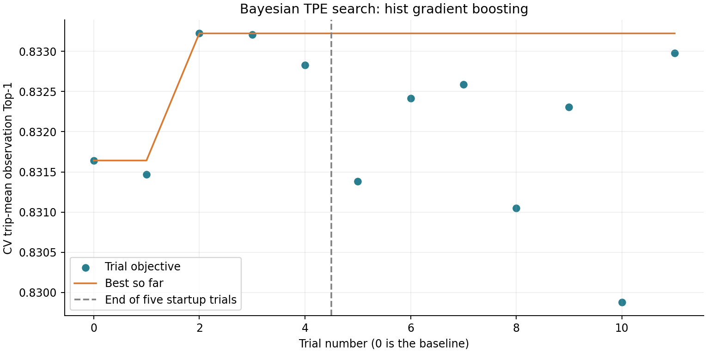
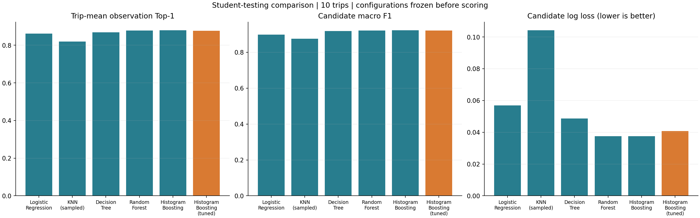
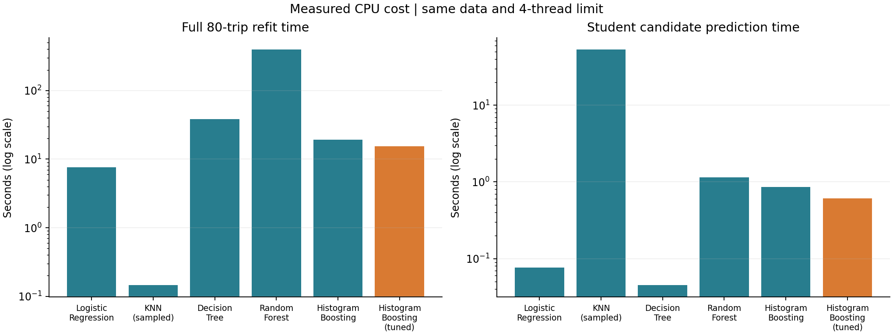
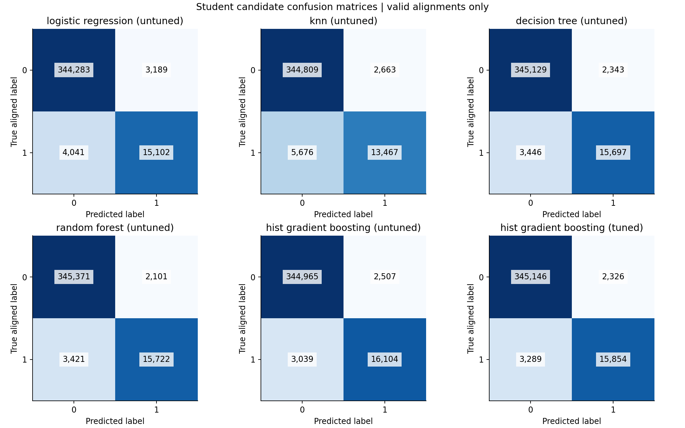
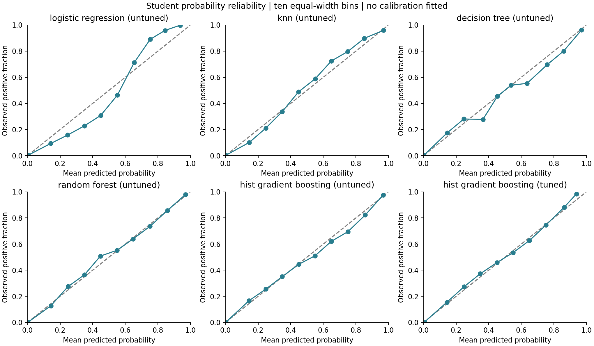

# PathSnap Member 2: model experiments and Bayesian optimisation

## Outcome

The strongest untuned model by CV Top-1 was **random_forest**. The promising family chosen for Bayesian tuning was **hist_gradient_boosting**. After 12 TPE trials, the frozen selection is **random_forest (untuned)**. Selection used development-trip CV only; neither holdout nor student-test scores selected models, thresholds or parameters.

The leading untuned CV model is ahead of the runner-up by 0.237 percentage points. The selected artifact follows the declared highest-CV-mean rule; this is not evidence of statistically proven superiority. The complete student comparison is shown below and did not change the frozen selection.

## Data and evaluation design

- Training: 80 trips, 208,417 GPS observations, 3,247,671 candidate rows.
- Valid route alignment: 199,233 observations (95.59%). Candidate miss rate among valid alignments: 6.17%.
- Student testing: 10 trips, 19,160 observations. Valid alignment: 99.98%; candidate miss rate: 0.07%.
- An initial GroupShuffleSplit reserved 16 of the 80 training trips as an internal holdout. The other 64 trips underwent 3-fold GroupKFold with identical folds for every model and tuning trial. All 80 training trips were used for final refits. No evaluator-testing data was read.
- Primary objective: observation Top-1 averaged equally across trips, then across all development trips. This limits domination by long trips. Pooled observation accuracy is also reported. Ties use lower candidate log loss.
- Invalid alignments are excluded from supervised metrics and training. Full-data models retain all candidates from valid alignments, including negative-only rows when the true arc is absent; KNN's training-only budget is documented below. Those misses and zero-candidate observations count as incorrect in unconditional Top-1; conditional Top-1 is reported separately.
- Median imputation is fitted on each training fold. Logistic Regression and KNN also use fold-fitted standardisation. The fixed 17 features are used; trip/observation/arc IDs and all label/alignment metadata are excluded.
- KNN uses at most 100 seeded training observations per trip, retaining every candidate of selected observations. An exact full-table attempt and backend benchmark established that its inference cost was prohibitive on this machine. Other models use every valid training row. Every model is evaluated on complete validation and testing partitions. Consequently the KNN comparison includes a model-specific fitting budget, rather than an equal-row training comparison; fitting-row counts are saved with every fold. The sampling policy is independent of candidate labels.
- KNN's sampled-training results do not establish how full-table KNN would perform; its reduced fitting budget is an explicit limitation of this resource-constrained comparison.
- Classification threshold is fixed at 0.5. Precision and recall refer to the positive candidate class. Macro F1 averages the two binary classes; log loss is candidate-level and row weighted. CV macro F1 is the unweighted mean of fold scores, not pooled F1.
- Timing includes fold-local preprocessing in fitting and candidate prediction. It excludes raw-data preparation, metric calculation, serialization and route decoding. All models use a 4-thread limit.

## Untuned model comparison

| model | family | top1_trip_mean | top1_pooled | macro_f1 | log_loss | fit_seconds | predict_seconds |
| --- | --- | --- | --- | --- | --- | --- | --- |
| logistic_regression | Linear/probabilistic | 0.8259 | 0.7652 | 0.8768 | 0.0810 | 24.6913 | 1.0336 |
| knn | Instance based | 0.7642 | 0.7087 | 0.8517 | 0.1773 | 0.2937 | 254.5322 |
| decision_tree | Tree | 0.8210 | 0.7644 | 0.8991 | 0.1011 | 106.5414 | 0.5707 |
| random_forest | Bagging ensemble | 0.8340 | 0.7736 | 0.9061 | 0.0549 | 900.6839 | 11.3466 |
| hist_gradient_boosting | Boosting ensemble | 0.8316 | 0.7715 | 0.9053 | 0.0540 | 94.8478 | 12.7644 |



## Bayesian optimisation

Histogram boosting was chosen as the promising tuning family after the five-model comparison because its measured Top-1 was close to Random Forest while fitting substantially faster. This was a practical compute decision, rather than a claim that it had the highest untuned Top-1. Final selection still compares its tuned CV score with the strongest untuned family.

Optuna's seeded Tree-structured Parzen Estimator (TPE) performed five startup trials followed by Bayesian-guided trials. Trial 0 records the already measured baseline. The same 3 trip-grouped folds and primary Top-1 objective were used for every trial. Search spaces vary model capacity, regularisation and learning rate as appropriate; their exact definitions are in models.py. No pruning or random-row early stopping was used.

Best trial: 2. Best parameters:

```json
{
  "learning_rate": 0.0403316977206044,
  "max_iter": 80,
  "max_leaf_nodes": 63,
  "min_samples_leaf": 52,
  "l2_regularization": 2.1745470981373622
}
```

Untuned CV trip Top-1: 0.831642; tuned CV trip Top-1: 0.833224. Untuned CV macro F1: 0.905313; tuned CV macro F1: 0.904227. The best tuning CV score is a selection score and can be optimistic; use the frozen holdout to assess the improvement.

Sum of recorded trial durations across tuning sessions: 664.4 seconds. Per-trial fold metrics and fit/predict costs are retained in tuning_trials.csv and the tuning folder. This excludes the aborted exploratory full-table KNN attempt, which is documented in experiment_amendment.json.



## Frozen internal holdout: tuned versus untuned

| model | variant | top1_trip_mean | top1_pooled | macro_f1 | log_loss | predict_seconds |
| --- | --- | --- | --- | --- | --- | --- |
| hist_gradient_boosting | untuned | 0.8560 | 0.7585 | 0.8625 | 0.0834 | 1.4599 |
| hist_gradient_boosting | tuned | 0.8548 | 0.7643 | 0.8664 | 0.0785 | 1.1092 |
| random_forest | strongest_untuned | 0.8532 | 0.7673 | 0.8697 | 0.0739 | 1.8576 |

Paired trip-mean Top-1 change: -0.118 percentage points. Exploratory 95% paired-trip bootstrap interval: [-0.401, +0.203] percentage points (16 held-out trips; 5,000 resamples). This interval describes trip variability, rather than proving superiority on future data.

## Student-testing comparison

| model | variant | top1_trip_mean | top1_pooled | macro_f1 | log_loss | candidate_miss_rate | predict_seconds |
| --- | --- | --- | --- | --- | --- | --- | --- |
| logistic_regression | untuned | 0.8622 | 0.8442 | 0.8982 | 0.0570 | 0.0007 | 0.0764 |
| knn | untuned | 0.8193 | 0.8091 | 0.8758 | 0.1042 | 0.0007 | 53.5772 |
| decision_tree | untuned | 0.8685 | 0.8497 | 0.9180 | 0.0487 | 0.0007 | 0.0449 |
| random_forest | untuned | 0.8781 | 0.8579 | 0.9213 | 0.0376 | 0.0007 | 1.1489 |
| hist_gradient_boosting | untuned | 0.8794 | 0.8628 | 0.9226 | 0.0376 | 0.0007 | 0.8570 |
| hist_gradient_boosting | tuned | 0.8769 | 0.8580 | 0.9207 | 0.0408 | 0.0007 | 0.6132 |

Each model was refitted on all 80 training trips before evaluating the same 10 student-testing trips. Student results are development comparisons, not evaluator-testing results. The preselected model is retained even if a different model happens to score better here. Student candidate coverage is much higher than training coverage, so their higher Top-1 scores should not be interpreted as an improvement measured on the same trip population.









## Individual model interpretation

### logistic_regression

A linear log-odds baseline, trained by regularised logistic loss. It tests whether distance and heading features suffice with additive effects. It cannot directly capture complex feature interactions; scaling and median imputation are fitted within each training fold.

Initial project configuration: `{"C": 1.0, "max_iter": 2000, "solver": "lbfgs"}`.

CV trip Top-1 0.8259, fold SD 0.0145; CV macro F1 0.8768. Student trip Top-1 0.8622, macro F1 0.8982, log loss 0.0570; prediction time 0.076 s for 366,633 candidates.

These held-out results assess transfer across trips. A CV-to-student difference can reflect distribution shift or sampling variability; without a matched training-score comparison, it does not independently establish overfitting.

### knn

A distance-weighted neighbourhood classifier in standardised feature space. It tests whether similar feature patterns have similar labels, without learning a parametric decision boundary. Its limitations are inference cost, sensitivity to feature geometry and potentially extreme probabilities. Raw bearing wrap-around remains a limitation of the supplied 17-feature representation.

Initial project configuration: `{"n_neighbors": 15, "weights": "distance", "algorithm": "brute", "leaf_size": 40}`.

CV trip Top-1 0.7642, fold SD 0.0165; CV macro F1 0.8517. Student trip Top-1 0.8193, macro F1 0.8758, log loss 0.1042; prediction time 53.577 s for 366,633 candidates.

These held-out results assess transfer across trips. A CV-to-student difference can reflect distribution shift or sampling variability; without a matched training-score comparison, it does not independently establish overfitting.

### decision_tree

A nonlinear Gini-impurity tree baseline. It learns distance/heading interactions through thresholds and is interpretable, but can overfit. Depth and minimum leaf size constrain complexity.

Initial project configuration: `{"max_depth": 12, "min_samples_leaf": 20}`.

CV trip Top-1 0.8210, fold SD 0.0044; CV macro F1 0.8991. Student trip Top-1 0.8685, macro F1 0.9180, log loss 0.0487; prediction time 0.045 s for 366,633 candidates.

These held-out results assess transfer across trips. A CV-to-student difference can reflect distribution shift or sampling variability; without a matched training-score comparison, it does not independently establish overfitting.

### random_forest

An ensemble of bootstrapped Gini-impurity trees. Feature subsampling and averaging test whether reduced tree variance improves transfer across trips. Its costs are fitting time, model size and potentially imperfect probability calibration.

Initial project configuration: `{"n_estimators": 120, "max_depth": 18, "min_samples_leaf": 10, "max_features": "sqrt"}`.

CV trip Top-1 0.8340, fold SD 0.0084; CV macro F1 0.9061. Student trip Top-1 0.8781, macro F1 0.9213, log loss 0.0376; prediction time 1.149 s for 366,633 candidates.

These held-out results assess transfer across trips. A CV-to-student difference can reflect distribution shift or sampling variability; without a matched training-score comparison, it does not independently establish overfitting.

### hist_gradient_boosting

A histogram-based tree ensemble trained with logistic loss. Sequential boosting learns feature interactions efficiently. Learning rate, iteration count, leaf complexity and regularisation control capacity. Internal random-row early stopping is disabled so that validation remains trip grouped.

Initial project configuration: `{"max_iter": 120, "learning_rate": 0.1, "max_leaf_nodes": 31, "min_samples_leaf": 30, "l2_regularization": 1.0, "early_stopping": false}`.

CV trip Top-1 0.8316, fold SD 0.0051; CV macro F1 0.9053. Student trip Top-1 0.8794, macro F1 0.9226, log loss 0.0376; prediction time 0.857 s for 366,633 candidates.

These held-out results assess transfer across trips. A CV-to-student difference can reflect distribution shift or sampling variability; without a matched training-score comparison, it does not independently establish overfitting.

## Limitations and integration

The non-ML nearest-road baseline achieved student trip Top-1 0.5545 and pooled Top-1 0.5280. It uses distance alone and has no classifier probabilities.

Scores measure agreement with Member 1's route-aligned observation labels. These labels are inferred using geometry and monotone route alignment, rather than independently annotated per-observation ground truth. Alignment errors and coverage therefore limit interpretation; consistency checks do not prove label correctness.

The supplied central heading and dt_next_s features use future GPS observations. These artifacts support offline trip reconstruction; causal streaming would require a separate feature configuration and retraining. Trip grouping prevents within-trip leakage but does not establish generalisation to entirely unseen cities or road networks.

The selected model returns binary candidate-match posterior probabilities. They are not automatically calibrated HMM emission likelihoods. score_candidates supplies clipped log scoring potentials for Member 3 to validate alongside transition scores. No additional calibration was fitted; reliability plots and Brier scores expose probability quality.

Member 3 owns HMM/Viterbi, route continuity and sequence-level evaluation; these have not been implemented here. No full-route accuracy or connectivity improvements are claimed from classifier scores alone.

The selected artifact is generated locally at models/selected_model.joblib under the experiment work directory; model binaries are excluded from Git. See ../pathsnap/MEMBER2_README.md for reproduction commands and the route-free scoring interface. Existing teammate modules were preserved. This folder publishes a compact snapshot of the locally generated experiments.

## Verification

37 unit tests passed, including the original Member 1 tests. The real-trip inference check regenerated 23,160 candidates for 2,503 GPS observations without reading a reference route. Feature values matched the evaluation tables, serialized model probabilities matched the stored results, candidate identities and input order were preserved, extra label metadata had no effect, and empty candidate tables were accepted. All 12 Bayesian trials are complete and the recorded source fingerprints match.
